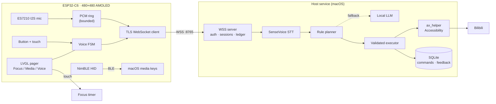

# esp32-ctrl

> Turn an ESP32 touchscreen into a physical control surface for your Mac — and, eventually, Windows.

`esp32-ctrl` is a firmware + host-service project. A small ESP32 with a 480×480 AMOLED
touchscreen sits on your desk and acts as a **hardware entry point** for controlling the
computer: start a focus timer, drive media playback over Bluetooth HID, or hold a button and
*speak* a command that the host executes against real applications.

The first shipped capability is voice control of **Bilibili** on macOS. The architecture is
deliberately application-agnostic so it can grow into a general desktop-control entry point.

---

## Why

Keyboard shortcuts are fast but blind. Phone apps are flexible but require picking up a phone.
`esp32-ctrl` explores a third option: **a dedicated, always-visible physical surface** with
direct manipulation for what is frequent (timer, play/pause, volume) and push-to-talk for what
is variable (search, open, navigate).

Design constraints that shaped the implementation:

- **Local-first audio.** Raw PCM never leaves your LAN. The host service performs STT and
  intent resolution on-device, and only the resulting action crosses into the OS.
- **Deterministic over generative.** A rule planner handles the common commands; a small local
  model is a *fallback* and is policy-constrained — it cannot invent a search it was not asked for.
- **Never break what already works.** The control surface must keep functioning when the host
  service, Wi-Fi, or the model is unavailable.

---

## Features

| Screen | Capability | Transport |
|---|---|---|
| 1 — Focus | Countdown timer, touch wheels, presets, gestures, pause/resume | On-device |
| 2 — Media | Mac media & volume: play/pause, next, previous, volume, mute | BLE HID (NimBLE) |
| 3 — Voice | Push-to-talk Bilibili control with cancel, plus a feedback overlay | TLS WebSocket → local host service |

**Screen 3 voice pipeline**

1. Physical button hold → I2S capture (16 kHz mono, ES7210 dual mic).
2. Bounded PCM ring buffer → binary WebSocket frames over TLS.
3. Host: SenseVoice STT → rule planner → optional local LLM fallback.
4. Validated action plan → macOS Accessibility (`ax_helper`) → Bilibili.
5. Result echoed to the device; a GOOD/BAD overlay feeds a personalization loop.

**Safety properties**: action whitelist (no arbitrary scripts), TLS certificate verification,
device token provisioning over USB, bounded timeouts/backpressure, and isolate-on-failure so a
dead host service cannot take down screens 1–2.

---

## Architecture



**Separation of concerns**

- The **device** owns input, capture, and display state. It never decides what a command means.
- The **host** owns interpretation, policy, and execution. It never renders UI.
- Commands are a **typed contract**; both sides validate independently.

---

## Quick start

Pick the entry point that matches what you have. Each path is independent — you do not need the
hardware to work on the host service, and you do not need the host service to work on the UI.

### Prerequisites

| Tool | Version | Needed for |
|---|---|---|
| macOS | 13+ (Apple Silicon or Intel) | Host service, Accessibility |
| Python | **3.11** (not 3.12+) | Host service — FunASR/torch wheels |
| arduino-cli | 1.0+ | Firmware |
| ESP32 core | 3.3.x (`esp32:esp32`) | Firmware |
| Xcode CLT | any recent | `swiftc` for `ax_helper` |
| Bilibili desktop app | latest | Voice control target |

`python3.11` specifically: `torch==2.14` and `funasr==1.4` have no wheels for 3.12+ yet.

---

### Path A — Host service only (no hardware)

For developing intent handling, protocol, and tests.

```bash
git clone https://github.com/Acache/esp32-ctrl.git
cd esp32-ctrl

./bootstrap.sh     # creates .venv, installs mac/requirements.lock, runs `setup`
./run.sh           # TLS WSS on :8765 (foreground)
```

`bootstrap.sh` is idempotent — re-running it upgrades the existing venv in place.

**Build the Accessibility helper** (required before any real app control):

```bash
mkdir -p mac/bin
swiftc -O -o mac/bin/ax_helper mac/scripts/ax_helper.swift
```

Grant it Accessibility: **System Settings → Privacy & Security → Accessibility → +**, then add
`mac/bin/ax_helper`. The path must stay stable — moving or rebuilding it may require re-granting.
Confirm:

```bash
./mac/bin/ax_helper trust     # -> {"ok": true, "trusted": true}
```

Data lives in `~/Library/Application Support/voice-assistant/` (mode `0700`), overridable with
`VOICE_ASSISTANT_DATA_DIR`. Nothing sensitive is written into the repository.

**STT model.** SenseVoiceSmall (`iic/SenseVoiceSmall`) is fetched from ModelScope by FunASR on
first use and cached under your user cache directory. The first start takes ~30–60 s and needs
network access; afterwards it loads locally in ~8 s. Set `VOICE_STT_MODEL_DIGEST` to pin a revision.

**LLM fallback is optional.** Without a local Ollama at `127.0.0.1:11434` serving `qwen2.5:1.5b`,
the rule planner handles all common commands by itself, and `doctor` simply reports the decision
layer as unavailable.

---

### Path B — UI only (LVGL simulator, no hardware)

Iterate on layout, fonts, and the pager without flashing anything.

```bash
cd tools/lv_sim
cmake -S . -B build && cmake --build build -j
./build/lv_sim
```

The simulator links **LVGL 9** (SDL2 window) and needs a checkout to point at:

```bash
cmake -S . -B build -DLVGL_DIR=/path/to/lvgl-9.x
```

Add `-DLVGL8_DIR=/path/to/lvgl-8.4` to also build the v8 renderer used by the hardware. SDL2 comes
from Homebrew (`brew install sdl2`). Files shipped as `*.c` under `firmware/desk-mate-app/` are
compiled by Arduino's build, not by this CMake project — so the simulator mirrors UI layout rather
than running the shipping sketch.

---

### Path C — Firmware only

```bash
arduino-cli core install esp32:esp32
arduino-cli lib install "NimBLE-Arduino" "XPowersLib" "ArduinoJson"
arduino-cli lib install "lvgl@8.4.0"
```

> **Firmware needs LVGL 8.x; the desktop simulator uses 9.x.** The sketch uses the v8 API
> (`lv_disp_drv_t`, `LV_FONT_DECLARE`) and will not compile against LVGL 9. The explicit `@8.4.0`
> is deliberate — plain `arduino-cli lib install lvgl` may resolve to 9.x. If both versions are
> installed system-wide, compile with `--libraries` pointing at the v8 tree.

```bash
arduino-cli compile \
  --fqbn 'esp32:esp32:esp32c6:CDCOnBoot=cdc,FlashSize=16M,PartitionScheme=no_ota' \
  --build-path build/firmware firmware/desk-mate-app

arduino-cli upload \
  --fqbn 'esp32:esp32:esp32c6:CDCOnBoot=cdc,FlashSize=16M,PartitionScheme=no_ota' \
  --port /dev/cu.usbmodem0001 --input-dir build/firmware
```

Every option in the FQBN matters:

| Flag | Why |
|---|---|
| `CDCOnBoot=cdc` | without it there is **no USB serial output** |
| `FlashSize=16M` | the board has 16 MB of flash |
| `PartitionScheme=no_ota` | the app needs the full app partition; OTA is unused |

Done when: the board boots to the Focus page, the serial log shows `READY heap=...`, and touch
plus PWR respond. Screens 1–2 work with no host service running at all.

---

### Path D — Full chain (hardware + host)

Everything from paths A and C, plus provisioning.

```bash
# 1. start the host
./run.sh

# 2. find the board
PYTHONPATH=mac/src .venv/bin/python -m voice_assistant.cli ports

# 3. provision Wi-Fi + device token over USB
PYTHONPATH=mac/src .venv/bin/python -m voice_assistant.cli pair \
  --port /dev/cu.usbmodem0001 --ssid '<your-2.4GHz-SSID>'
```

Omit `--ssid`/`--password` to use the device's SoftAP provisioning mode instead of USB serial.

> The SoftAP fallback broadcasts SSID `Desk-Mate-Voice` with a **fixed default password**
> (`deskmate`), compiled into the firmware. Treat it as a convenience for first-time setup only:
> provision over USB where possible, and change the constant in
> `firmware/desk-mate-app/src/bili_voice/transport.cpp` if you deploy this anywhere untrusted.

Credentials go to device NVS only and are never echoed back. To keep the password out of your
shell history, pass it via `--password "$(read -rs -p 'WiFi: ' p; echo $p)"`.

The Wi-Fi must be **2.4 GHz** — the ESP32-C6 has no 5 GHz radio. If the Mac and the board land on
different subnets (guest network, AP isolation), voice stays disconnected: both must reach each
other on port 8765.

Done when: `doctor` reports `accessibility: true`, screen 3 shows `net=READY`, and holding the
button produces a transcribed command in `cli status`.

---

### Verify

```bash
PYTHONPATH=mac/src .venv/bin/python -m pytest mac/tests -q   # host unit + integration
PYTHONPATH=mac/src .venv/bin/python -m voice_assistant.cli doctor
```

`doctor` checks macOS, Python, data root, port availability, Bilibili presence, `ax_helper` trust,
Accessibility, Screen Recording, STT health, Ollama health, device count, and temp/disk space.
Whatever comes back `false` and matters to you is your actionable blocker.

### Troubleshooting quick hits

| Symptom | Cause | Fix |
|---|---|---|
| No serial output after flash | FQBN missing `CDCOnBoot=cdc` | recompile with the full FQBN |
| `accessibility: false` | helper not granted, or its path changed | re-add `mac/bin/ax_helper` in System Settings |
| STT `MODEL_TIMEOUT` | first-run model download | run once with network, then retry |
| Screen 3 `net=TLS_RETRY` | host not running, or TLS trust failed | `cli doctor`; check port 8765 |
| Voice command does nothing | Bilibili not frontmost / AX tree not built | focus the app, confirm it is running |
| `pair` cannot find the port | board in a different CDC mode | `cli ports`, or hold BOOT and replug |

---

## Hardware

| Item | Detail |
|---|---|
| Board | ESP32-C6-Touch-AMOLED-2.16 (480×480, SH8601 panel, FT5x06 touch) |
| MCU | ESP32-C6 — Wi-Fi 6 (2.4 GHz) + BLE 5 |
| PMIC | AXP2101 (battery gauge, power rails) |
| Audio | ES7210 dual-mic ADC → I2S |
| Storage | 16 MB flash, no-OTA partition scheme |

Pin map: [`firmware/desk-mate-app/pinout.md`](firmware/desk-mate-app/pinout.md)
Button semantics: [`firmware/desk-mate-app/button_plan.md`](firmware/desk-mate-app/button_plan.md)

---

## Repository layout

```
firmware/desk-mate-app/       Arduino sketch — the complete device application
  desk-mate-app.ino           Entry: pager, boot, main loop, owner bridge
  focus_ui.h / focus_model.h  Screen 1: timer UI and state machine
  media_ble.h                 Screen 2: BLE HID media/volume
  src/bili_voice/             Screen 3: capture, FSM, transport, provisioning
  src/port_bsp/               AXP2101 + I2C board support
  src/externLib/              SH8601 panel driver
firmware/test/                Native C tests for audio and voice FSM
mac/src/voice_assistant/      Host service: protocol, STT, planner, executor
mac/tests/                    Unit + integration tests
tools/lv_sim/                 LVGL desktop simulator
scripts/                      Provisioning and packaging helpers
```

Third-party Arduino libraries are **not vendored**. Install them as shown in Quick Start.

---

## Design notes

- **Single sketch, three pages.** New functionality was added as pages inside the existing
  pager rather than as a separate firmware, so switching features needs no reflash.
- **Static-singleton boundary.** `focus_ui.h` and `media_ble.h` hold singleton state owned by
  the `.ino` translation unit. New C++ modules communicate through an owner bridge and events
  instead of including those headers, avoiding duplicated timers, UI, and BLE state.
- **Page-owned input routing.** Voice-page input never falls through to legacy HID or timer
  actions; ownership is explicit and asserted.
- **Bounded memory.** PCM ring of 64 frames, two 10-line draw buffers, 32 KiB LVGL pool —
  measured against real device heap rather than assumed.

See `firmware/desk-mate-app/TODO.md` for current known gaps.

---

## Roadmap

- [x] Focus timer with touch wheels and presets
- [x] BLE HID media/volume control
- [x] Push-to-talk Bilibili voice control over TLS WSS
- [x] Feedback overlay + personalization data collection
- [ ] Generalized app control (beyond Bilibili) via a pluggable adapter interface
- [ ] Windows host service
- [ ] Wake-word entry (hands-free)
- [ ] Published prebuilt firmware images

The long-term goal is a **portable desktop-control endpoint**: the same device, the same
protocol, different host backends.

---

## License

[MIT](LICENSE)
